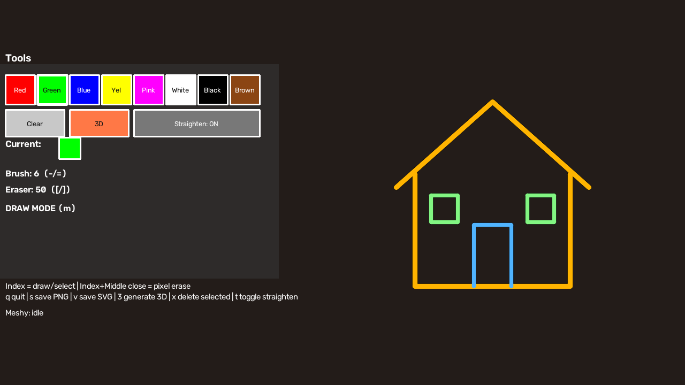

# Hand Drawing → SVG → 3D

**Draw in the air with a webcam, turn strokes into SVG artwork, and optionally generate a 3D model.**

A Python computer-vision application combining **OpenCV**, **MediaPipe Hand Landmarker**, gesture interaction and geometric stroke processing. The drawing tools and PNG/SVG exports run locally; the optional image-to-3D step uses Meshy's API.

*Preview uses synthetic strokes, not a camera capture.*

## Features

- **Air drawing:** track the index fingertip, change colours and adjust brush size.
- **Stroke cleanup:** moving-average smoothing, PCA-based line-intent detection and Ramer–Douglas–Peucker simplification, with heuristics to preserve curved/closed strokes.
- **Pixel erasing:** mask painted pixels without deleting the stored stroke geometry; draw over erased regions to paint again.
- **Selection:** switch modes, select a nearby stroke and delete it.
- **Exports:** save PNGs or vectorise coloured regions into SVG paths using quantisation, morphology and contour extraction.
- **Optional 3D:** submit the drawing canvas to Meshy in a background thread, follow progress and save a GLB model.

## Setup

Tested with **Python 3.12**. Use a virtual environment and install the pinned dependencies:

~~~bash
git clone https://github.com/mariamlats/HandDrawing.git
cd HandDrawing
python -m venv .venv
~~~

Activate it with `source .venv/bin/activate` on macOS/Linux, or `.venv\Scripts\activate` in Windows Command Prompt. Then:

~~~bash
python -m pip install -r requirements.txt
python tools/download_model.py
python GUI_hand_drawing.py
~~~

The explicit model-download step retrieves the official MediaPipe hand-landmarker asset and verifies a pinned SHA-256 checksum. Subsequent drawing sessions use the local model; startup does not download one automatically.

You need a webcam, camera permission and a desktop/display session for the OpenCV window. On Linux, MediaPipe also needs EGL/GLES runtime libraries, such as the Debian/Ubuntu **libegl1** and **libgles2** packages.

## Controls

| Gesture | Action |
| --- | --- |
| Index finger raised, middle finger lowered | Draw, or select in selection mode |
| Index + middle fingers raised and pinched together | Pixel eraser |
| Thumb + middle pinch over a toolbar button | Activate the tool while pointing with the index finger |

| Key | Action |
| --- | --- |
| q | Quit |
| m | Toggle drawing/selection |
| x | Delete the selected stroke |
| s / v | Save PNG / SVG |
| 3 | Request 3D generation when explicitly enabled |
| t | Toggle automatic straightening |
| - / = | Decrease/increase brush size |
| [ / ] | Decrease/increase eraser size |
| c | Clear strokes and eraser mask |
| r | Reset the eraser mask |

Gesture thresholds use image pixels, so camera resolution, hand distance and lighting affect interaction.

## Optional Meshy integration

Copy `.env.example` to `.env` and explicitly enable the integration:

~~~dotenv
MESHY_ENABLED=true
MESHY_API_KEY=your_own_key
MESHY_AUTO_OPEN=false
~~~

Pressing the 3D button/key then uploads **the drawing canvas**, not the webcam preview, to the external provider. Meshy generation may consume paid credits. No 3D requests are made during startup or tests.

The client uses the [official Image-to-3D API](https://docs.meshy.ai/en/api/image-to-3d), bounds polling and download size, rejects redirects, and accepts model downloads only from the approved HTTPS asset host. API credentials are not sent to the asset server. Models are checked for a GLB v2 header/length before being saved.

Downloaded models are **not opened automatically** by default. You can enable local opening explicitly, or inspect a saved model in a viewer of your choice. If a request times out, check the Meshy dashboard before submitting again: stopping local polling does not cancel an already submitted remote job.

## Processing pipeline

1. Run the local hand-landmarker model on camera frames.
2. Convert landmarks to drawing, eraser and toolbar gestures.
3. Store coloured polylines and smooth/simplify completed strokes.
4. Render strokes, apply the eraser mask and blend with the camera preview.
5. Export the standalone drawing canvas as PNG or vectorised SVG.
6. Optionally upload that PNG for external image-to-3D generation.

SVG export traces the rendered coloured regions; it does not preserve the original stroke objects as editable SVG centre lines. Near-black pixels are treated as background during vectorisation. The 3D result is generated by Meshy, not by a model trained in this repository.

## Outputs and project layout

~~~text
GUI_hand_drawing.py       Gestures, stroke geometry, rendering and main loop
hand_tracker.py           MediaPipe Tasks adapter
model_asset.py           Model download/checksum verification
meshy_client.py          Optional API polling and bounded GLB downloads
tools/download_model.py  Explicit model setup
tests/                   Geometry, export, file and network-client checks
models/                  Downloaded model asset (ignored by Git)
outputs/                 PNG, SVG and GLB exports (ignored by Git)
~~~

Output names include a timestamp and random suffix so repeated exports do not overwrite each other. The environment file, generated models and exports are excluded from version control.

## Verification

~~~bash
python -m pip install -r requirements-dev.txt
python -m pytest -q
python -m pip_audit -r requirements.txt
~~~

The automated tests use synthetic arrays and mocked HTTP responses; they need no webcam or API key and make no paid requests. The current hand-landmarker model was also loaded for a local blank-frame inference check. Live camera ergonomics and actual Meshy generation still need testing on a desktop with your own hardware/account.
